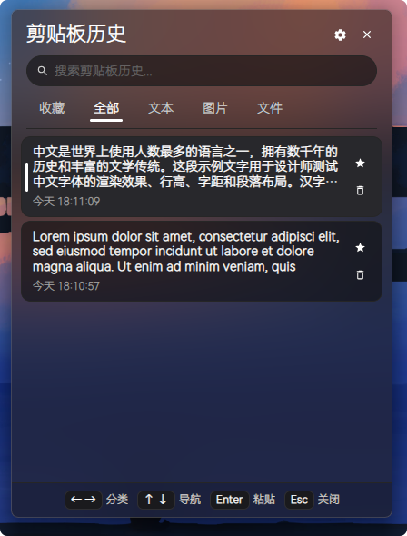
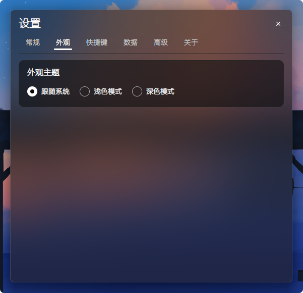

# SlimClip

> 极简、流畅、纯本地运行的跨平台剪贴板管理工具。

[](https://creativecommons.org/licenses/by-nc-sa/4.0/)
[](https://github.com/Promisin/SlimClip)
[](https://github.com/Promisin/SlimClip/releases)

---

## 界面预览

<div align="center">
  <table style="border: none; background: transparent;">
    <tr style="border: none; background: transparent;">
      <td align="center" valign="bottom" style="border: none; padding: 12px;">
        
        <br />
        <sub><b>主面板</b></sub>
      </td>
      <td align="center" valign="bottom" style="border: none; padding: 12px;">
        
        <br />
        <sub><b>设置面板</b></sub>
      </td>
    </tr>
  </table>
</div>

---

## 核心特性

- **极简设计**：界面克制、功能聚焦，无冗余多余元素与弹窗打扰，随用随走。
- **纯本地运行**：不连网、无云端依赖、不收集隐私数据。历史记录与缓存图片全部保存在本地磁盘。
- **双端原生支持**：深度融合 Windows（Fluent 2 亚克力）与 macOS（Apple HIG 液态玻璃）推荐设计语言。

---

## 下载与安装

前往 **[Releases 最新发布页面](https://github.com/Promisin/SlimClip/releases)** 下载对应版本：

### Windows (Windows 10 / 11)
- **安装版**：下载 `SlimClip-vX.Y.Z-windows-x64-setup.exe`，按向导一键完成安装。
- **便携版**：下载 `SlimClip-vX.Y.Z-windows-x64.zip`，解压后直接运行 `SlimClip.exe`（数据保存在解压目录中）。

### macOS (Apple Silicon)
1. 下载 `SlimClip-vX.Y.Z-macos-arm64.dmg`。
2. 双击打开，将 **SlimClip** 拖入 **Applications（应用程序）**。

> [!TIP]
> **macOS 首次打开提示“无法打开 / 已损坏”时：**  
> 打开终端执行以下命令清除系统隔离属性：
> ```bash
> xattr -cr /Applications/SlimClip.app
> ```

---

## 常用快捷键

| 操作 | Windows 快捷键 | macOS 快捷键 | 说明 |
| :--- | :--- | :--- | :--- |
| **呼出 / 隐藏** | `Alt + Shift + V` | `⇧⌘V` | 悬浮弹出或收起面板 |
| **选中并粘贴** | `Enter` 或 双击 | `Enter` 或 双击 | 复制所选内容并自动粘贴至当前窗口 |
| **切换分类** | `←` / `→` | `←` / `→` | 切换 全部 / 收藏 / 文本 / 图片 / 文件 |
| **浏览列表** | `↑` / `↓` | `↑` / `↓` | 向上 / 向下选择历史记录 |
| **聚焦搜索框** | `Tab` | `Tab` | 从列表快速切回搜索框 |
| **收藏 / 置顶** | `Ctrl + P` | `⌘P` | 将选中记录加入收藏并置顶 |
| **删除记录** | `Ctrl + Delete` | `⌘Delete` | 物理删除当前选中的记录项 |
| **关闭面板** | `Esc` 或 点击外部 | `Esc` 或 点击外部 | 关闭面板，后台继续监听剪贴板 |

*所有快捷键均可在设置面板中自定义。*

---

## 开源协议与免责声明

本项目基于 **[CC BY-NC-SA 4.0 (知识共享署名-非商业性使用-相同方式共享 4.0 国际许可协议)](LICENSE)** 开源：
- **允许**：个人非商业用途免费使用、学习、修改及分发。
- **禁止**：未经授权将本项目或衍生版本用于任何商业盈利目的。
- **相同方式共享**：基于本项目的衍生作品必须以相同的 CC BY-NC-SA 4.0 协议开源，并保留原作者署名。

本项目按照“现状”（AS-IS）提供，不承担因使用本软件或其剪贴板数据所产生的任何连带责任。第三方开源组件与字体版权授权信息详见 **[ACKNOWLEDGEMENTS.md](ACKNOWLEDGEMENTS.md)**。
